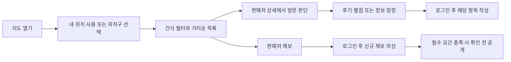

# 서비스 기획서 (Service Planning Document)

| 항목 | 내용 |
| --- | --- |
| 프로젝트명 | 겨울한입 · 서울 겨울간식 지도 |
| 문서 ID · 버전 | SPD-WINTER-v0.1 |
| 작성일 | 2026-11-24 |
| 작성자 | 기획 초안 · Codex |
| 문서 상태 | 검토 전 초안 |
| 승인 | G0 미승인 · 승인자와 승인일은 검토 시 기록 |

## 변경 이력

| 버전 | 날짜 | 변경 내용 |
| --- | --- | --- |
| v0.1 | 2026-11-24 | 소비자 탐색, 서울 범위, 제보 즉시 공개 방침과 상세·리뷰 요구를 반영 |

## 목차

1. [서비스 개요](#1-서비스-개요)
2. [핵심 메커니즘](#2-핵심-메커니즘)
3. [콘텐츠와 기능 전략](#3-콘텐츠와-기능-전략)
4. [수익화 전략](#4-수익화-전략)
5. [MVP 스코프 정의](#5-mvp-스코프-정의)
6. [KPI 가설 검증 프레임워크](#6-kpi-가설-검증-프레임워크)
7. [다음 단계](#7-다음-단계)
8. [관련 문서](#8-관련-문서)

## 1. 서비스 개요

**겨울한입은 서울에서 원하는 겨울간식을 파는 곳을 찾아 방문을 결정할 수 있는 모바일 웹 지도다.** 붕어빵, 호떡, 군고구마, 어묵 등을 내 위치 가까운 순으로 살펴보거나 가고 싶은 자치구를 골라 찾아볼 수 있다. 판매처 상세에는 위치, 판매 메뉴, 영업시간, 포장·매장 이용 방식, 방문자 후기와 별점을 함께 제공한다.

### 사용자 문제와 근거

| ID | 사용자 문제 | 근거와 확인할 가설 |
| --- | --- | --- |
| PROB-001 | 원하는 간식이 가까운 곳 어디에 있는지 파악하기 어렵다. | 서비스 요청에서 내 위치 거리순과 자치구 선택이 필요하다고 명시했다. 두 지도에서 같은 간식 이름을 검색한 결과, 관련 업종과 검색어에 간접적으로 연관된 결과가 함께 나타났다. [DESIGN.md](https://github.com/Uzn1/gyeoul-hanip/blob/main/DESIGN.md) |
| PROB-002 | 위치를 찾아도 실제 메뉴, 영업시간, 포장·매장 이용 정보가 흩어져 있다. | 사용자 요청에 상세 항목과 후기·별점이 명시됐다. 이 정보가 방문 판단에 얼마나 기여하는지는 정성 테스트로 확인한다. |
| PROB-003 | 계절 노점과 소규모 매장의 정보는 늦게 갱신되고 중복될 수 있다. | 기존 기획은 주민 제보, 최근 현장 확인, 중복 병합을 포함한다. 신규 제보가 실제로 자료의 빈틈을 메우는지는 운영 실험에서 확인한다. [Plan.md](https://github.com/Uzn1/gyeoul-hanip/blob/main/Plan.md) |

### 핵심 가치와 사용자

- **주 사용자**는 집에 가는 길이나 외출 중에 간식을 살 소비자다. 위치 권한을 허용한 이용자는 가까운 판매처를, 권한을 허용하지 않은 이용자는 선택한 자치구의 판매처를 바로 찾는다.
- **제보 기여자**는 다녀온 판매처나 새로 발견한 판매처를 공유하는 주민이다. 가게 주인도 메뉴·영업 정보를 제보할 수 있다.
- **운영자**는 오류 신고, 중복 병합, 출처 관리와 정보 갱신을 맡는다. 별도 사업주 대시보드의 필요성은 초기 운영 결과로 판단한다.

## 2. 핵심 메커니즘

### 2.1 서비스 작동 원리

1. 소비자가 지도에 들어오면 지도와 가까운 판매처 목록을 함께 본다. 내 위치를 허용하면 거리를 다시 계산한다. 자치구, 간식 종류, 검색어를 선택하면 같은 조건을 두 화면에 적용한다.
2. 목록이나 핀을 누르면 상세를 연다. 위치와 판매 메뉴를 먼저 보여 주고, 영업시간, 이용 방식, 정보 출처, 후기·별점이 뒤따른다. 정보가 없으면 해당 항목에 미등록 또는 확인 전으로 표시한다.
3. 주민이나 사업주가 제보를 작성한다. 필수 요건을 갖춘 새 판매처는 **확인 전**으로 바로 공개한다. 기존 후보가 같은 판매처면 새 핀 대신 기존 정보에 제보한다.
4. 방문자는 판매 정보 확인, 오류 신고, 후기·별점으로 정보를 보완한다. 운영자가 중복 핀을 병합할 때 출처와 기존 기록을 함께 보존한다. 세부 조건은 [비즈니스 정책서](비즈니스정책서.md)에 둔다.

### 2.2 전체 서비스 흐름

후기 작성과 정보 정정은 각각의 공개·심사 규칙을 따른다.

### 2.3 핵심 사용자 여정

| 여정 | 진입 → 완료 | 실패 시 대안 |
| --- | --- | --- |
| J-001 가까운 붕어빵 찾기 | 내 위치 허용 → 붕어빵 필터 → 거리순 후보 → 메뉴·영업시간·포장 조건 확인 | 권한 거부 시 서울시청 기준 거리와 자치구 선택 제공 |
| J-002 목적지 근처에서 찾기 | 갈 예정인 자치구 선택 → 지도와 목록 확인 → 상세에서 주소·찾는 법 확인 | 결과가 비면 필터 초기화와 판매처 제보 제공 |
| J-003 정보 보태기 | 판매처 제보 또는 상세의 후기 작성 → 로그인 → 제출 → 공개 상태나 처리 결과 확인 | 필수 입력 누락 시 안내, 중복 후보가 있으면 기존 핀으로 이동 |

## 3. 콘텐츠와 기능 전략

| 영역 | 방향 | 판단 기준 |
| --- | --- | --- |
| 지도와 목록 | 간식 종류와 자치구를 쉽게 바꾸고, 선택한 핀과 상세를 연결한다. | 소비자가 핀과 목록 중 어느 쪽에서 시작해도 같은 판매처를 열 수 있다. |
| 매장 상세 | 판매처 이름, 메뉴와 위치를 먼저 배치한다. 영업시간, 포장·매장 이용, 후기·별점은 방문 판단에 필요한 순서로 둔다. | 확인된 정보의 출처와 갱신일을 알 수 있고 빈 값도 구별된다. |
| 초기 판매처 | 네이버 지도와 카카오맵에서 각각 30곳을 목표로 서울 판매처의 위치와 간식 종류를 검증한다. 같은 실물 판매처는 한 핀에 출처를 함께 기록한다. | 출처별 검증 수와 중복 제거 후 공개 핀 수를 따로 집계한다. 현장 확인을 하지 않은 정보에는 방문 확인 시각을 부여하지 않는다. |
| 주민·사업주 기여 | 같은 진입점에서 시작하고 출처와 작성자 유형을 기록한다. 사업주 표시는 운영 확인이 끝난 계정에 한해 적용하는 안을 검토한다. | 정보 출처를 구분할 수 있고 정정·중복 신고의 결과를 추적할 수 있다. |
| 후기 | 실제 이용 경험을 적고 1–5점 별점을 남길 수 있게 한다. | 자사 후기 개수와 평점이 일치하고 이용자 본인이 후기를 수정·삭제할 수 있다. |

지도 중심 탐색과 내 주변 진입은 두쫀쿠맵의 실제 화면을 참고한다. 겨울한입의 첫 방문 판단 기준은 **판매처의 위치와 취급 메뉴**이며, 상세에서 정보의 확인 시점을 드러낸다. 디자인은 [DESIGN.md](https://github.com/Uzn1/gyeoul-hanip/blob/main/DESIGN.md)의 지도·목록 대응, 간식 색과 아이콘, 모바일 배치를 따른다. [두쫀쿠맵](https://www.dubaicookiemap.com/)

## 4. 수익화 전략

MVP는 공개 무료 조회를 전제로 소비자 탐색과 자료 갱신 가설을 검증한다. 광고, 유료 입점, 결제의 사업 모델은 G0 결정 범위에 두지 않는다. 유료화 검토가 생기면 위치 거리순 정렬과 판매처 공개 조건에 미치는 영향을 먼저 평가한다.

## 5. MVP 스코프 정의

### 5.1 MVP 목표

서울에서 원하는 겨울간식의 판매처를 찾고, 방문 전에 필요한 정보를 확인하고, 틀리거나 빠진 정보를 보탤 수 있는지 검증한다. 아래는 기획 초안의 포함 범위다. 일정, 구현 공수, 출시 순서는 G0에서 결정한다.

### 5.2 포함 항목

| ID | 항목 | 수용 기준으로 쓸 관찰 결과 | 우선순위 | 연결 |
| --- | --- | --- | --- | --- |
| MVP-001 | 공개 지도·거리순 목록 | 로그인 없이 조회된다. 위치 허용 시 기준점이 내 위치로 바뀌고 거부 시 서울시청 기준으로 계속 탐색한다. | P1 | PROB-001 · BP-MAP-001 |
| MVP-002 | 서울 자치구·간식·검색 | 같은 조건으로 지도 핀과 목록이 바뀐다. 선택 결과가 없으면 빈 상태가 보인다. | P1 | PROB-001 · BP-MAP-002 |
| MVP-003 | 판매처 상세 | 위치, 메뉴, 영업시간, 이용 방식, 출처와 후기 영역을 확인할 수 있다. 미확정 항목이 읽힌다. | P1 | PROB-002 · BP-INFO-001~003 |
| MVP-004 | 제보와 중복 관리 | 승인된 필수 요건을 통과한 신규 핀이 확인 전 상태로 바로 공개된다. 기존 핀 제보와 운영자 병합이 가능하다. | P1 | PROB-003 · BP-REP-001~003 |
| MVP-005 | 작성 권한과 후기·별점 | 조회는 공개다. 작성자는 로그인 후 자기 후기 1개를 작성·수정·삭제할 수 있다. | P1 · 인증 방식 미결 | PROB-002 · BP-AUTH-001~003 · BP-REV-001~002 |
| MVP-006 | 초기 데이터와 출처 | 서울 매장·노점의 메뉴·위치를 확인하고 출처 링크를 남긴다. 제공처별 목표와 실제 공개 핀 수를 각각 보고한다. | P1 | PROB-003 · BP-SRC-001~002 |
| MVP-007 | 방문 확인과 오류 신고 | 최근 방문 확인과 현재 가게 등록 상태가 별도로 읽힌다. 오류 신고가 운영자에게 전달된다. | P2 | PROB-003 · BP-TIME-001~002 · BP-REP-003 |

### 5.3 제외 항목과 재검토 조건

| ID | 항목 | 이번 범위의 판단 기준 | 재검토 조건 |
| --- | --- | --- | --- |
| EX-001 | 실시간 재고 수량과 예약 | 서비스의 첫 과제는 해당 간식을 취급하는 판매처를 찾는 것이다. | 실제 방문 조사에서 재고 정보 요구가 반복되고 갱신 주체가 확보될 때 |
| EX-002 | 결제, 배달, 대기열 | 방문 탐색 가설과 운영 자원을 먼저 검증한다. | 소비자 수요와 담당 운영 체계가 확인될 때 |
| EX-003 | 지역 확장, 사업주 전용 대시보드 | 첫 범위는 서울과 공통 제보 흐름이다. | 서울 운영 지표 및 사업주 제보 수요를 검토한 뒤 |
| EX-004 | 외부 리뷰·별점 이관 | 후기의 작성 맥락과 집계 근거는 서비스 자체 기록에 둔다. | 출처 표시, 이용 조건, 데이터 정정 권한을 검토한 뒤 |

## 6. KPI 가설 검증 프레임워크

아래 수치는 이전 시범 기획에서 나온 **검토용 목표**와 새로 제안하는 측정을 구분한다. 기준값은 미측정이며 서울 공개 범위 전체의 목표로 해석하지 않는다.

| KPI · 가설 | 산식과 분모 | 대상·기간 · 초안 기준 | 증거 · 담당 |
| --- | --- | --- | --- |
| KPI-001 · H-001 탐색이 방문 판단으로 이어진다 | 판매처 상세에서 주소·메뉴를 확인하고 후보를 고른 탐색 과제 수 ÷ 유효 탐색 과제 수 | 출시 전 소비자 과제 테스트 · 최소 표본과 목표는 G0에서 결정 | 시나리오별 관찰표 · 기획·QA |
| KPI-002 · H-002 주민이 정보를 보탠다 | 유효한 방문 또는 정정 제보를 1건 이상 남긴 비운영 계정 수 | 운영 실험 2주 · 기존 계획안 5명 이상 | 중복과 테스트 계정을 제외한 운영 기록 · 운영 |
| KPI-003 · H-002 초기 판매처 정보가 갱신된다 | 둘째 주에 주민 방문 제보가 있는 판매처 수 ÷ 실험 시작 시 확정한 현장 확인 판매처 수 | 고정 표본 10곳 · 기존 계획안 50% 이상 | 실험 전 대상 명단과 대상별 방문 기록 · 운영 |
| KPI-004 · H-003 상세 정보가 부족한 항목을 찾을 수 있다 | 영업시간 또는 이용 방식이 등록된 활성 핀 수 ÷ 해당 관찰 집단의 활성 핀 수 | 표본과 목표는 G0에서 결정 | 상세 데이터 점검표 · 운영 |

**판정 방식.** 표본을 충족해 목표에 도달하면 다음 범위를 검토한다. 탐색 성공이 낮으면 자치구·간식 필터와 상세에서 멈추는 지점을 살핀다. 기여가 부족하면 제보 완료 흐름과 초기 핀의 품질을 확인한다. 표본 부족이나 로그 손실 시 판정은 보류한다. 운영 실험은 별도 측정표로 시작하고 위치 권한의 원시 좌표를 지표에 남기지 않는다.

## 7. 다음 단계

### 7.1 G0 체크리스트

- [x] 소비자 중심 탐색 목표, 서울 확대, 신규 제보의 확인 전 즉시 공개 방향을 기록했다.
- [x] 지도·상세·제보·리뷰의 초안 범위와 관련 정책 ID를 연결했다.
- [ ] PRD 원본과 대조하고, 제보 필수 기준·확인 상태 전환·계정 정책을 승인한다.
- [ ] 출시 범위, 담당자, 실험 지역·표본과 KPI 판정일을 확정한다.
- [ ] 승인 후 SRS·유스케이스·RTM에서 범위와 수용 조건을 이어 받는다.

### 7.2 후속 검토

초기 확대는 서울에서 가게가 적은 자치구와 겨울 노점의 자료 품질을 먼저 점검한다. 이후 사업주 정보 관리와 상세 정보 갱신 지원을 검토한다. 일정과 사업자 계정 제공 시점은 G0에서 확정한다.

### 7.3 가정·의존성·미결 결정

| ID | 결정하거나 확인할 내용 | 담당 역할 · 기한 | 상태 · 영향 |
| --- | --- | --- | --- |
| DEC-001 | 별도 `PRD.md` 원본과 대조하고 충돌하는 범위를 정리한다. | 기획 · G0 승인 전 | 미결 · 확인 가능한 `Plan.md`, `DESIGN.md`, 최신 사용자 합의를 근거로 초안을 작성했다. |
| DEC-002 | 로그인 제공자와 세션 방식, 사업주 자격 확인 수준을 결정한다. | 기획·개발 · SRS 확정 전 | 미결 · 현재 공개 앱은 ChatGPT 로그인으로 제보한다. 공개 소비자 흐름에 쓸 로그인 제공자는 미확정이다. |
| DEC-003 | 신규 판매처의 최소 증빙, `확인 전` 해제 조건, 오류 처리 기한을 확정한다. | 기획·운영 · G0 승인 전 | 즉시 공개 방향 합의 · 세부 조건 초안은 정책서에 기록했다. |
| DEC-004 | 리뷰의 작성·신고와 운영 원칙을 승인한다. | 기획·운영 · G0 승인 전 | 미결 · 별점·후기 제공은 요구에 포함된다. 작성 제한과 숨김 기준은 검토안이다. |
| DEC-005 | 서울 초기 데이터의 출처별 확인 수와 현장 실험 표본을 정한다. | 운영 · 공개 반영·실험 시작 전 | 30곳씩 조사 목표 합의 · 실제 등록 수, 실험 자치구, 목표 판정일은 미확정이다. |
| DEC-006 | 공개 앱 버전과 문서의 신규 범위를 분리해 구현·검증 현황으로 관리한다. | 개발·QA · SRS 작성 전 | 미결 · 저장소 문서와 현재 배포에서 확인되는 동작을 기준으로 초기 추적표를 만든다. |

## 8. 관련 문서

| 자료 | 쓰임 |
| --- | --- |
| [AGENT.md](../AGENT.md) | 워터폴 Phase 0 형식과 승인 기준 |
| [비즈니스 정책서](비즈니스정책서.md) | 조건, 결과, 예외 및 미결 정책 |
| [Plan.md](https://github.com/Uzn1/gyeoul-hanip/blob/main/Plan.md) | 기존 시범 범위와 운영 기준의 출발점 |
| [DESIGN.md](https://github.com/Uzn1/gyeoul-hanip/blob/main/DESIGN.md) | 카카오맵·네이버 지도 비교, 지도 및 목록 설계 |
| [두쫀쿠맵](https://www.dubaicookiemap.com/) | 내 주변 탐색과 데이터 기여 구조 참고 |
| [SRS](../01-요구사항분석/요구사항명세서-SRS.md) · [RTM](../01-요구사항분석/요구사항추적매트릭스-RTM.md) | G0 이후 범위 ID와 정책 ID를 요구사항·테스트로 연결 |
| [단계별 검토 체크리스트](../08-검토/단계별검토-체크리스트.md) | G0 승인 근거와 승인자 기록 |

## 부록 · 용어와 승인

| 용어 | 의미 |
| --- | --- |
| 판매처 | 고정 매장이나 장소를 식별할 수 있는 계절 노점 |
| 확인 전 | 입력 요건을 충족해 공개됐고, 정해진 확인 기준을 아직 충족하지 않은 판매처 |
| 방문 확인 | 현장에서 사용자 또는 운영자가 남긴 시각이 있는 기록 |
| 지도 출처 | 판매처 위치와 소개를 확인한 외부 장소 페이지 링크 |

**승인 기록**은 기획 책임자, 운영 책임자, 기술 검토자가 G0 검토 때 남긴다. 현재 승인 기록은 없다.
