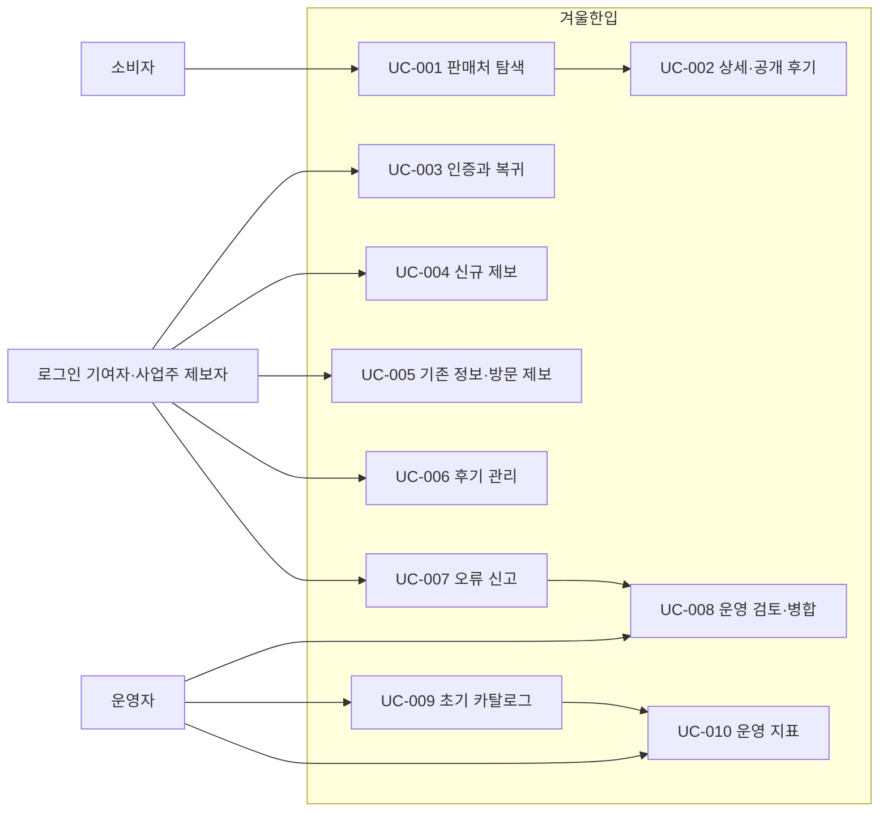

# 유스케이스 명세서

| 항목 | 내용 |
| --- | --- |
| 프로젝트 | 겨울한입 · 서울 겨울간식 지도 |
| 문서 ID · 버전 | UC-WINTER-v0.1 |
| 작성일 · 작성자 | 2026-11-24 · Codex |
| 상태 | 검토 전 초안 · G1 미승인 |
| 기준 문서 | SPD-WINTER-v0.1 · BPD-WINTER-v0.1 · SRS-WINTER-v0.1 |

## 변경 이력

| 버전 | 날짜 | 변경 내용 |
| --- | --- | --- |
| v0.1 | 2026-11-24 | 소비자 탐색부터 제보·후기·운영까지 정상·대안·예외 흐름 작성 |

## 목차

1. [유스케이스 다이어그램](#1-유스케이스-다이어그램)
2. [액터 정의](#2-액터-정의)
3. [유스케이스 목록](#3-유스케이스-목록)
4. [유스케이스 상세 명세](#4-유스케이스-상세-명세)

## 1. 유스케이스 다이어그램

UC-003은 쓰기 작업에서 로그인 세션이 없을 때만 실행된다. UC-002는 로그인 없이 시작할 수 있다. UC-009와 UC-010의 결과는 내부 운영 기록으로 관리할 수 있다.

## 2. 액터 정의

| ID | 액터 | 책임과 범위 |
| --- | --- | --- |
| ACT-001 | 소비자 | 지도·자치구·간식을 탐색하고 상세, 출처와 공개 후기를 읽는다. |
| ACT-002 | 로그인 기여자 | 공개 조회와 함께 신규·기존 판매처 제보, 오류 신고, 자기 후기 관리를 수행한다. |
| ACT-003 | 사업주 제보자 | 공통 제보 흐름을 쓴다. 확인된 사업주 권한과 검증 방식은 DEC-002에서 확정한다. |
| ACT-004 | 운영자 | 관리 권한으로 사례를 검토하고 출처 정리·병합·실험 집계를 수행한다. |
| ACT-005 | 브라우저 위치 기능 | 이용자의 허용 여부에 따라 현재 좌표나 실패 결과를 반환한다. |
| ACT-006 | 인증 제공자 | 작성 계정의 세션을 확인한다. 운영 서비스 선택은 DEC-002에서 확정한다. |

## 3. 유스케이스 목록

| ID | 목표 | 주요 액터 | 화면 · 관련 요구사항 |
| --- | --- | --- | --- |
| UC-001 | 원하는 간식의 판매처 탐색 | ACT-001 | UI-01 · FR-001~003, FR-017 |
| UC-002 | 상세와 공개 후기로 방문 판단 | ACT-001 | UI-02 · FR-001, FR-004, FR-012, FR-016 |
| UC-003 | 작성자 로그인, 복귀, 로그아웃 | ACT-002, ACT-003 | UI-03 · FR-005 |
| UC-004 | 신규 판매처 제보 | ACT-002, ACT-003 | UI-04 · FR-005~007, FR-017 |
| UC-005 | 기존 판매처의 정보·방문 제보 | ACT-002, ACT-003 | UI-02, UI-05 · FR-005, FR-007, FR-008, FR-015~017 |
| UC-006 | 후기와 별점 작성·수정·삭제 | ACT-002 | UI-06 · FR-005, FR-011, FR-012, FR-017 |
| UC-007 | 잘못된 판매처 정보 신고 | ACT-002, ACT-003 | UI-05 · FR-005, FR-008, FR-017 |
| UC-008 | 신고 검토, 상태 갱신과 중복 병합 | ACT-004 | UI-07 · FR-008~010 |
| UC-009 | 초기 판매처와 출처 등록 | ACT-004 | UI-07 · FR-013, FR-014 |
| UC-010 | 실험과 초기 등록 집계 | ACT-004 | 운영 기록 · FR-014 |

## 4. 유스케이스 상세 명세

### UC-001 판매처 탐색

**시작과 사전 조건.** 소비자가 공개 주소를 연다. 브라우저 위치는 선택 입력이다.

1. 시스템이 서울의 공개 지도와 거리순 목록을 표시한다.
2. 소비자가 내 위치를 요청한다. 브라우저가 허용하면 시스템이 내 위치 기준을 표시하고 거리를 다시 정렬한다.
3. 소비자가 자치구·간식·검색어를 선택한다. 지도와 목록이 같은 조건에서 갱신되고 결과 수가 바뀐다.
4. 소비자가 핀 또는 목록을 선택해 UC-002로 간다.

| 흐름 | 조건과 결과 |
| --- | --- |
| 대안 A1 | 위치 미허용·실패 시 서울시청 기준으로 정렬하고 탐색을 계속한다. |
| 대안 A2 | 조건에 맞는 판매처가 0곳이면 빈 상태에서 필터 초기화와 제보를 안내한다. |
| 예외 E1 | 판매처 조회 실패 시 오류와 재시도를 표시한다. |

**사후 조건.** 판매처 데이터에 변경이 없다. 표시한 조건과 기준점을 소비자가 확인할 수 있다.  
**정책·순서.** BP-AUTH-001, BP-MAP-001, BP-MAP-002, BP-ERR-001. UI-01, FR-001~003, FR-017.

### UC-002 판매처 상세와 공개 후기 읽기

**시작과 사전 조건.** 소비자가 열 수 있는 공개 핀 또는 결과 행을 선택한다.

1. 시스템이 선택된 판매처 ID의 이름, 위치, 주소 또는 찾는 법과 판매 메뉴를 표시한다.
2. 영업시간·이용 방식·지도 출처와 공개 후기·평점을 표시한다.
3. 방문 확인을 제공하는 경우 최근 이력과 기준 시점을 표시한다. 소비자는 같은 화면에서 작성 작업 또는 오류 신고를 선택할 수 있다.

| 흐름 | 조건과 결과 |
| --- | --- |
| 대안 A1 | 영업시간이나 이용 방식이 비어 있으면 해당 항목에 미등록·확인 전을 표시한다. 후기 0건은 후기 없음으로 읽힌다. |
| 대안 A2 | 확인 전 판매처는 그 상태를 표시한다. 외부 링크만 있는 경우 현장 확인 시각을 추가하지 않는다. |
| 예외 E1 | 핀이 병합 또는 숨김되어 더는 원래 ID로 열 수 없으면 지도를 갱신하거나 대표 핀을 확인하도록 안내한다. |

**사후 조건.** 같은 판매처의 위치와 정보를 확인할 수 있다. 공개 후기 읽기에는 로그인이 필요하지 않다.  
**정책·순서.** BP-AUTH-001, BP-INFO-001~003, BP-REV-002, BP-TIME-001~002. UI-02, FR-001, FR-004, FR-012, FR-016.

### UC-003 로그인하고 작성 작업으로 복귀

**시작과 사전 조건.** 게스트가 보호된 작성 작업을 선택한다.

1. 시스템은 현재 선택한 판매처와 작성할 동작을 확인한다.
2. 소비자가 승인된 인증 제공자로 로그인한다.
3. 인증 성공 시 시스템은 원래 판매처와 작성 화면을 연다.
4. 로그아웃을 선택하면 세션을 종료하고 공개 탐색을 계속 제공한다.

| 흐름 | 조건과 결과 |
| --- | --- |
| 대안 A1 | 유효한 세션이 있으면 로그인 화면을 거치지 않고 해당 작성 작업으로 이어진다. |
| 예외 E1 | 인증 취소·실패 또는 세션 만료 시 보호된 쓰기를 성공으로 처리하지 않고 공개 탐색 또는 재인증을 안내한다. |
| 예외 E2 | 로그인 사용자가 타인 후기나 운영 작업을 직접 요청하면 서버에서 거절한다. |

**사후 조건.** 인증 전에는 쓰기 데이터가 생성되지 않는다. 세션과 인증 제공자는 DEC-002의 결정을 따른다.  
**정책·순서.** BP-AUTH-002, BP-AUTH-003. UI-03, FR-005, NFR-002.

### UC-004 신규 판매처 제보

**시작과 사전 조건.** 주민 또는 사업주가 판매처 제보를 선택한다. 게스트는 UC-003을 먼저 수행한다.

1. 제보자가 서울 지도 위의 위치를 지정한다.
2. 시스템이 근처 기존 판매처를 보여준다. 제보자는 새 가게인지 확인한다.
3. 제보자가 승인된 최소 입력과 증빙을 제출한다. 검토안은 이름, 자치구, 핀, 간식 종류, 찾는 법 또는 공개 출처다.
4. 유효한 새 판매처는 `확인 전`으로 공개되고 제보자가 생성된 상세를 확인한다.

| 흐름 | 조건과 결과 |
| --- | --- |
| 대안 A1 | 후보 중 같은 곳을 선택하면 신규 핀을 생성하지 않고 UC-005로 이동한다. |
| 대안 A2 | 핀을 다시 지정하면 승인된 흐름에서 작성한 내용의 입력값을 최대한 유지한다. |
| 예외 E1 | 필수 입력 누락이나 서울 지역 밖 핀은 해당 필드를 안내하고 저장하지 않는다. |
| 예외 E2 | 네트워크·저장 오류가 발생하면 성공으로 표시하지 않고 입력과 재시도 수단을 제공한다. |

**사후 조건.** 성공 시 대상 판매처가 한 건 생성되고 확인 전으로 표시된다. 구체적인 증빙·후보 반경·해제 조건은 DEC-003을 따른다.  
**정책·순서.** BP-AUTH-002, BP-REP-001~003, BP-ERR-002. UI-04, FR-005~007, FR-017.

### UC-005 기존 판매처 정보 또는 방문 결과 제보

**시작과 사전 조건.** 로그인 기여자가 상세 또는 신규 위치 선택의 기존 후보에서 제보를 시작한다.

1. 시스템이 기존 판매처 ID를 유지한다.
2. 기여자는 메뉴·영업시간·이용 방식의 정정 정보 또는 판매 중·품절·위치 미발견이라는 현장 관찰을 제출한다.
3. 시스템은 종류, 제출 시각과 대상 ID를 기록한다. 정정 자료는 운영 검토가 필요할 경우 UC-008로 연결한다.
4. 승인된 표시 정책에 따라 현장 기록과 최신 확인 정보를 별도로 반영한다.

| 흐름 | 조건과 결과 |
| --- | --- |
| 대안 A1 | 사업주도 공통 제보를 사용한다. 자격 확인에 따른 직접 수정은 승인된 경우에만 제공한다. |
| 대안 A2 | 위치 미발견은 현장 이력에 남긴다. 마지막 판매처 확인 시점은 유지된다. |
| 예외 E1 | 시스템이 제출 중 대상 병합이나 네트워크 오류를 발견하면 재확인·재시도를 안내한다. |

**사후 조건.** 방문 기록과 제보 대상의 연결이 남는다. 검토 중 변경과 공개 정보의 차이를 유지한다.  
**정책·순서.** BP-AUTH-002~003, BP-INFO-003, BP-REP-003, BP-TIME-001~002, BP-ERR-002. UI-02, UI-05, FR-005, FR-007, FR-008, FR-015~017.

### UC-006 후기와 별점 작성·수정·삭제

**시작과 사전 조건.** 로그인 기여자가 공개 판매처의 후기 영역을 연다.

1. 기여자가 별점과 후기 입력란에 값을 넣는다.
2. 시스템은 승인된 범위의 별점과 입력, 작성자 소유권과 기존 후기 여부를 확인한다.
3. 저장이 완료되면 공개 후기와 후기 수·평균을 같은 데이터로 갱신한다.
4. 기여자는 자기 후기를 수정·삭제할 수 있다. 삭제 뒤 공개 목록과 집계가 바뀐다.

| 흐름 | 조건과 결과 |
| --- | --- |
| 대안 A1 | 판매처별 1건 정책 승인 시 동일 작성자의 추가 작성은 자기 후기 수정으로 유도한다. |
| 대안 A2 | 공개 후기 0건은 평균 없이 후기 없음으로 표시한다. |
| 예외 E1 | 승인 범위 밖 별점, 타인 후기 수정이나 잘못된 입력은 거절한다. |
| 예외 E2 | 저장 중 실패 시 입력을 보존하고 완료 여부를 알려준다. |

**사후 조건.** 승인된 개수와 집계 원칙에 맞게 공개 목록과 평점이 일치한다. 후기 문구·신고와 숨김은 DEC-004를 따른다.  
**정책·순서.** BP-AUTH-002~003, BP-REV-001~002, BP-ERR-002. UI-06, FR-005, FR-011, FR-012, FR-017.

### UC-007 정보 오류 신고

**시작과 사전 조건.** 로그인 기여자가 기존 판매처 상세에서 신고를 선택한다.

1. 신고자가 잘못된 위치, 중복 또는 폐점 의심을 선택하고 확인에 필요한 내용을 제출한다.
2. 시스템은 대상과 신고 사유를 운영 검토 대상으로 기록한다.
3. 신고자에게 접수 결과를 표시한다.

| 흐름 | 조건과 결과 |
| --- | --- |
| 대안 A1 | 중복 사유일 때 승인된 흐름에서 대응 판매처를 함께 표시한다. |
| 예외 E1 | 유효하지 않은 대상 또는 저장 오류에는 재확인·재시도 안내를 표시한다. |

**사후 조건.** 공개 상태는 접수만으로 바뀌지 않고 운영자가 UC-008에서 결과를 결정한다.  
**정책·순서.** BP-AUTH-002, BP-REP-003, BP-ERR-002. UI-05, FR-005, FR-008, FR-017.

### UC-008 운영 검토와 중복 핀 병합

**시작과 사전 조건.** 운영자가 확인 전 후보, 신고 또는 정정 자료를 검토한다.

1. 운영자가 판매처 기록, 방문·신고, 출처를 확인한다.
2. 승인된 기준에 따라 확인 상태·정보를 갱신하거나 중복 후보에서 대표 핀을 선택한다.
3. 시스템은 담당자, 시각과 처리 근거를 기록한다. 중복 병합 시 출처·방문·신고 이력은 대표 핀에 연결하고, 후기 충돌은 승인된 규칙으로 처리한다.
4. 운영자는 계속 조회되는 대표 핀과 처리 이력을 확인한다.

| 흐름 | 조건과 결과 |
| --- | --- |
| 대안 A1 | 근거가 부족하면 확인 전 상태를 유지하거나 승인된 기준에 따라 추가 검토한다. |
| 대안 A2 | 폐점 의심 신고는 확인 근거와 승인된 숨김·복원 규칙에 따라 처리한다. |
| 예외 E1 | 필요 권한이 없거나 이미 처리된 요청이면 다른 기록이 바뀌지 않는다. |
| 예외 E2 | 병합 중 실패가 나면 일부 이력만 옮겨진 상태로 완료되지 않는다. |

**사후 조건.** 공개 핀과 관련 이력에 적용된 변경 및 처리 근거를 확인할 수 있다. 확인 전 해제는 DEC-003, 후기 충돌은 DEC-004에 따른다.  
**정책·순서.** BP-AUTH-003, BP-REP-002~003, BP-REV-002. UI-07, FR-008~010, NFR-002, NFR-004~005.

### UC-009 초기 카탈로그 출처 등록

**시작과 사전 조건.** 운영자가 서울의 후보와 출처 목록을 준비한다.

1. 출처에서 위치와 해당 간식 종류를 확인한다.
2. 같은 시설을 가리키는 출처는 동일 실물 판매처에 묶는다. 지점이 다르면 각각 구분한다.
3. 이용 조건과 공개 대상 항목을 확인한 후보를 반영하고 출처 링크를 남긴다.
4. 출처별 조사 건수와 중복 제거 공개 핀 건수를 각각 보고한다.

| 흐름 | 조건과 결과 |
| --- | --- |
| 대안 A1 | 두 지도에 같은 가게가 있으면 공개 핀 한 개에 두 링크를 연결한다. |
| 예외 E1 | 위치·메뉴 확인 또는 출처 이용 검토가 부족하면 공개 반영 후보에서 보류하고 사유를 기록한다. |

**사후 조건.** 출처별 목표 대비 실적을 확인할 수 있다. 온라인 조회가 현장 확인이나 앱 별점으로 기록되지 않는다.  
**정책·순서.** BP-SRC-001~002, BP-STAT-001. UI-07 또는 운영 기록, FR-013, FR-014.

### UC-010 시범 운영 지표 계산

**시작과 사전 조건.** 실험 계획, 대상 판매처, 기간과 운영·테스트 계정 목록이 정해져 있다.

1. 운영자가 고정 실험 표본과 해당 기간의 기록을 대조한다.
2. 비운영 유효 제보자 수와 둘째 주 방문 확인을 받은 표본 판매처 비율을 각각 계산한다.
3. 출처별 조사 수, 실제 공개 수와 실험 집계 결과를 구분해 기록한다.

| 흐름 | 조건과 결과 |
| --- | --- |
| 대안 A1 | 공식 실험 기준이 확정되기 전에는 기존 10곳·2주 가설을 검토안으로 표시한다. |
| 예외 E1 | 고정 분모, 기간 또는 계정 분류를 증명할 수 없으면 판정을 보류한다. |

**사후 조건.** 지표의 분자·분모, 원본 기록과 판정 상태에 근거가 남는다.  
**정책·순서.** BP-STAT-001. 운영 기록, FR-014, KPI-002, KPI-003.

## 부록 · 참고 문서

- [AGENT.md](../AGENT.md) · [서비스기획서](../00-기획/서비스기획서.md) · [비즈니스정책서](../00-기획/비즈니스정책서.md)
- [SRS](요구사항명세서-SRS.md)의 화면 ID 및 [RTM](요구사항추적매트릭스-RTM.md)의 검증 후보
- [DESIGN.md](https://github.com/Uzn1/gyeoul-hanip/blob/main/DESIGN.md)의 지도·목록·상세·제보 시각 참고
