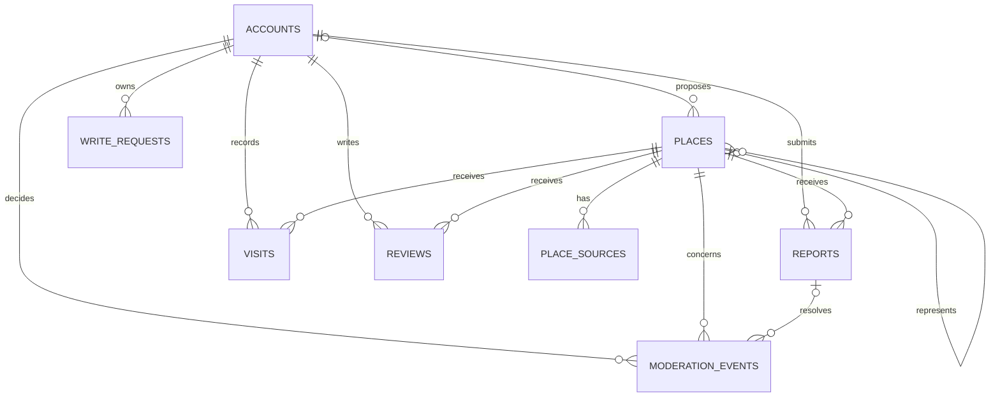

# 데이터베이스 설계서

| 항목 | 내용 |
| --- | --- |
| 프로젝트 · 문서 | 겨울한입 · DBS-WINTER-v0.1 |
| 작성일 · 작성자 | 2026-11-24 · Codex |
| 상태 | G2 검토용 초안 · 승인 기록 없음 |
| DBMS 기준선 | Cloudflare D1 · SQLite · Drizzle 마이그레이션 |

## 변경 이력

| 버전 | 날짜 | 변경 |
| --- | --- | --- |
| v0.1 | 2026-11-24 | 판매처·후기·운영 이력의 스키마, 병합 트랜잭션과 전환 계획 정의 |

## 1. 설계 개요

서울 공개 카탈로그, 판매처 정보, 제보·방문 이력, 후기와 운영 결정을 저장한다. 공개 장소와 방문 시점에 대한 기록은 별도로 생명주기를 관리한다. 이용자의 현재 위치 원시는 수집 대상에서 제외한다. 제보자가 확정한 좌표는 공개 판매처 위치로 보존한다.

설계는 [SRS](../01-요구사항분석/요구사항명세서-SRS.md), [비즈니스정책서](../00-기획/비즈니스정책서.md), [API 설계서](API설계서.md)와 연결된다. 아래 이름은 목표 스키마다. 시범 스키마의 `places`, `visits`, `flags`에서 전환하는 절차는 5장에 있다.

## 2. ER 다이어그램



## 3. 테이블 명세서

공통 ID 타입은 `TEXT`다. 새 ID는 서버가 쓰기 전에 생성한다. 기존 숫자 ID는 같은 내용의 문자열로 이관한다. 저장 시각은 UTC 밀리초 `INTEGER`이며 API가 ISO 8601로 변환한다. 아래 `?` 표시는 `NULL` 허용을 뜻한다.

| 테이블 | 주요 칼럼과 타입 | 관계와 인덱스 |
| --- | --- | --- |
| `accounts` | `id TEXT PK`, `provider TEXT`, `provider_subject TEXT`, `role TEXT`, `created_at INTEGER` | `UNIQUE(provider, provider_subject)`. 역할은 `CONTRIBUTOR, OPERATOR`. 사업주 검증용 필드의 범위는 DEC-002에서 정한다. |
| `places` | `id TEXT PK`, `name TEXT`, `district TEXT?`, `lat REAL`, `lng REAL`, `address TEXT?`, `directions TEXT?`, `categories_json TEXT`, `menus_json TEXT`, `opening_hours_json TEXT?`, `service_mode TEXT?`, `verification_status TEXT`, `visibility TEXT`, `revision INTEGER`, `author_id TEXT?`, `created_at INTEGER`, `updated_at INTEGER`, `merged_into_id TEXT?` | `author_id → accounts`, `merged_into_id → places`. 공개 경로는 `(visibility, district, id)` 인덱스 후보. 기존 구역 미확정 자료에서만 자치구 `NULL`을 허용한다. |
| `place_sources` | `id TEXT PK`, `place_id TEXT`, `kind TEXT`, `external_key TEXT?`, `url TEXT?`, `checked_at INTEGER?` | `place_id → places`. `(place_id, kind)`. 외부 키가 있는 경우 `UNIQUE(kind, external_key)`. 한 실물 가게에 여러 출처를 둔다. |
| `reports` | `id TEXT PK`, `place_id TEXT`, `original_place_id TEXT`, `author_id TEXT`, `kind TEXT`, `notes TEXT?`, `duplicate_place_id TEXT?`, `proposed_changes_json TEXT?`, `status TEXT`, `created_at INTEGER`, `resolved_at INTEGER?` | 현재·원래·중복 대상은 `places`, 작성자는 `accounts` 참조. `(status, created_at DESC, id DESC)`, `(place_id, created_at DESC, id DESC)`. |
| `visits` | `id TEXT PK`, `place_id TEXT`, `original_place_id TEXT`, `author_id TEXT`, `status TEXT`, `recorded_at INTEGER` | 현재와 원래 대상은 `places`, 작성자는 `accounts` 참조. `(place_id, recorded_at DESC, id DESC)`. |
| `reviews` | `id TEXT PK`, `place_id TEXT`, `original_place_id TEXT`, `author_id TEXT`, `stars INTEGER`, `body TEXT?`, `status TEXT`, `created_at INTEGER`, `updated_at INTEGER` | 현재와 원래 대상은 `places`, 작성자는 `accounts` 참조. 공개 목록 `(place_id, status, created_at DESC, id DESC)`. DEC-004의 한 건 기준이 승인되면 활성 후기 유일 인덱스 적용. |
| `moderation_events` | `id TEXT PK`, `actor_id TEXT`, `place_id TEXT`, `target_place_id TEXT?`, `report_id TEXT?`, `action TEXT`, `reason TEXT`, `created_at INTEGER` | 운영자·대상·신고 FK. `(place_id, created_at DESC, id DESC)`. 처리 경위와 병합 대표를 확인하는 내부 이력. |
| `write_requests` | `id TEXT PK`, `actor_id TEXT`, `method TEXT`, `path TEXT`, `request_key TEXT`, `request_hash TEXT`, `result_status INTEGER`, `result_json TEXT?`, `created_at INTEGER` | `actor_id → accounts`, `UNIQUE(actor_id, method, path, request_key)`. 결과 영수증과 멱등성의 완료 기록. 저장 기간은 DEC-007을 따른다. |

같은 계정 매핑에 사용되는 제공자 주체와 내부 ID를 공개 응답에 포함하지 않는다. 예전 작성자 ID의 출처를 확인할 수 없는 경우 별도의 이관 계정으로 기록을 보존한다. 입증된 매핑 없이 이관 계정을 현재 사용자의 소유권에 연결하지 않는다.

## 4. 데이터 사전과 상태 규칙

| 항목 | 허용 값과 제약 |
| --- | --- |
| 좌표·자치구 | WGS84. DB는 위도 −90~90과 경도 −180~180의 기본 범위를 적용한다. 신규 공공 판매처는 서버에서 승인된 서울 경계와 자치구를 검증한다. 정확한 경계 자료·경계선 처리는 DEC-003에서 확인한다. |
| 메뉴·영업 | `categories_json`에는 정해진 간식 키를 1개 이상 사용한다. `menus_json`은 이름 배열이다. `opening_hours_json`은 API 계약의 주간 구간·참고 문구이며 값이 없으면 `NULL`이다. |
| 이용 방식 | `TAKEOUT_ONLY, DINE_IN_ONLY, BOTH` 또는 `NULL`. `NULL`은 이용 방식 확인 전이다. |
| 존재 확인 | `verification_status`는 `UNVERIFIED, VERIFIED`. 유효한 신규 사용자 제보는 `UNVERIFIED`로 시작한다. 전환 기준은 DEC-003을 적용한다. |
| 공개 여부 | `visibility`는 `PUBLIC, HIDDEN, MERGED`. `MERGED`에만 다른 판매처 ID가 있고 일반 판매처에는 대표 ID가 없다. 병합 그래프의 순환을 금지한다. |
| 출처 | `NAVER, KAKAO, RESIDENT, OWNER`. 제공처별 공개 조건을 확인한다. 외부 지도 출처 등록은 방문 기록과 별점을 생성하지 않는다. |
| 제보·신고 | `kind`는 `NEW_PLACE, INFO_CORRECTION, WRONG_PIN, DUPLICATE, SUSPECTED_CLOSED`. 신규 판매처 기록은 생성 완료 영수증으로 `RESOLVED`, 정정·신고는 `PENDING`으로 접수한다. |
| 방문 상태 | `SELLING, SOLD_OUT, NOT_FOUND`. 최근 방문은 시간 내림차순과 ID로 동순위를 처리한다. 마지막 현장 확인 시점은 판매 중 또는 품절 기록 중 최신 시각이다. |
| 후기 상태 | `PUBLIC, HIDDEN, DELETED`. 검토안의 `stars`는 1~5 정수다. 집계에 `PUBLIC`만 포함한다. 본문 기준과 숨김 처리·충돌 기준은 DEC-004에서 정한다. |
| 변경 버전 | `places.revision`은 1 이상. 장소 정보, 확인·공개 상태와 해당 운영 결정이 성공 커밋되면 버전이 증가한다. 단순 방문 기록 추가와 후기 집계 변화는 운영 버전을 올리는 조건에서 제외한다. |

출처 URL은 정규화 후 공개 가능한 링크만 반환한다. 확인 전 상태나 미확정 정보는 앱 응답에 값의 의미를 유지한다. 오늘 상태는 한국 날짜를 기준으로 조회 시 파생한다. 7일 기준을 유지하는 경우 마지막 현장 확인부터 7일이 지난 시점에 최근 확인 필요를 표시한다.

### 4.1 일관성과 트랜잭션

1. **신규 생성과 재시도.** 요청 키와 해시를 조회한다. 유효한 요청은 고유 쓰기 실행 ID로 단건 등록하고, 판매처·신규 제보·해당 출처·성공 영수증을 한 배치에서 저장한다. 동시 재시도에서 같은 키 기록을 확보하지 못한 실행은 비즈니스 데이터를 변경하지 않고 완료 기록을 조회한다.
2. **운영 결정.** 운영 권한 확인 후 현재 대상과 기대 버전, 필요한 신고와 상태 조건을 쓰기 배치 안에서 다시 검사한다. 승인된 변경과 감사 이벤트를 하나의 결과로 남긴다. 조건 불일치로 쓰기를 시작하지 못한 경우 충돌 응답을 반환한다.
3. **병합.** 원본과 대표 ID, 두 기대 버전, 병합 가능한 후기 상태를 단건 실행으로 확정한다. 현재 연결된 출처·방문·신고·후기를 대표로 옮기고 원래 대상 ID와 운영 이력을 보존한다. 중복 신고의 현재 대상과 대응 대상이 같아지면 처리 결과를 남긴다. 마지막에 원본을 `MERGED`로 전환하고 대표를 연결한다.
4. **동시성.** 쓰기 승인 조건을 SQL에 둔다. 조건을 충족하지 못한 실행의 나머지 SQL은 해당 실행 ID에 종속되어 행을 변경하지 않아야 한다. 유일 제약 위반과 중간 오류는 전체 배치를 실패시킨다. 병합과 일반 쓰기가 경합하면 일반 쓰기도 활성 판매처 조건을 저장 시점에 다시 검사한다. [D1 배치 계약](https://developers.cloudflare.com/d1/worker-api/d1-database/#batch)
5. **후기 충돌.** 같은 작성자의 활성 후기가 두 장소에 있을 때 DEC-004 승인 전에는 병합을 보류한다. 병합 뒤 현재 공개 모집단을 조회해 목록·평균·건수가 일치하도록 한다.

아래는 적용 조건이 확정된 후기 유일성과 집계의 SQLite 예시다.

```sql
CREATE UNIQUE INDEX reviews_one_active_per_author_place
ON reviews (place_id, author_id)
WHERE status IN ('PUBLIC', 'HIDDEN');

SELECT COUNT(*) AS count, AVG(stars) AS average
FROM reviews
WHERE place_id = ? AND status = 'PUBLIC';
```

## 5. 마이그레이션 전략

| 순서 | 작업과 확인 기준 |
| --- | --- |
| 1. 기준 기록 | 공개 시범 커밋과 적용된 Drizzle SQL, 테이블·읽기 API를 대조한다. 로컬 변경과 공개 버전을 구분한다. |
| 2. 확장 | 검증 D1에 신규 구조를 추가한다. 기존 마이그레이션은 그대로 두고 확장 SQL과 데이터 전환 작업을 분리한다. v1 구조를 병행할 동안 기존 쓰기는 구계약만 사용한다. |
| 3. 변환 | 검증 DB에서 숫자 ID를 같은 문자열로 보존한다. 기존 `categories, lat, lng, directions`를 매핑한다. `selling/sold_out/missing`은 각 신형 상태로, `flags`는 대응 신고로 옮긴다. 근거 없는 영업시간·확인 상태·후기를 채우지 않는다. |
| 4. 대조와 전환 | 원본·대표 ID, 병합 연결, 작성자 매핑, 출처와 이력 수를 대조한다. 쓰기 정지 창을 사용한다면 전환 직전 마지막 변경까지 이관하고, 신형 UI·API 검증 뒤 쓰기를 내부 승인 절차로 재개한다. |
| 5. 호환과 재실행 | 소스 키와 이관 매핑으로 재실행 시 중복을 방지한다. 기존 요청의 호환 결과나 화면 새로고침 안내를 검증한다. v1 쓰기 이후 구버전 재활성화는 데이터 대조·복구를 거친다. |

## 6. 인덱스, 통계와 보존

- 공개 지도에는 공개 판매처만 투영한다. 초기 데이터량에서 활성 공개 범위를 한 번 읽고 현지 필터링을 검증한다. DB 질의는 활성·대상·시간 인덱스를 사용한다. 인덱스는 검증 데이터에서 실행 계획과 조회 시간으로 확인한다.
- 출처별 확인 수는 검토한 입력 파일의 출처 키, 공개 실물 수는 대표 장소 ID 기준으로 계산한다. 실험에는 시작 시 고정한 대상 명단과 운영·테스트 계정 제외 규칙을 승인된 운영 기록에 연결한다.
- 후기 평균은 공개 행에서 계산한다. 상세 API의 공개 페이지와 집계가 같은 조회 시점의 공개 조건을 사용하도록 한다. 집계 캐시는 검증에서 병목이 확인될 때 다시 검토한다.

## 7. 백업·복구와 검토

운영 전환 전의 복구 지점과 스키마 버전을 기록한다. 검증 환경에 복원해 판매처 수, 대표 ID, 비공개 범위와 이력·후기 합계가 맞는지 확인한다. 지원되는 복구 방식, 보존 기간과 복구 목표, 장애 시 담당자·승인자는 DEC-007에서 확정한다.

[AGENT.md](../AGENT.md) · [SAD](시스템아키텍처설계서-SAD.md) · [API 설계서](API설계서.md) · [RTM](../01-요구사항분석/요구사항추적매트릭스-RTM.md)을 함께 검토한다. 주요 연결은 FR-006~016, NFR-001~002, NFR-004~006이다.
