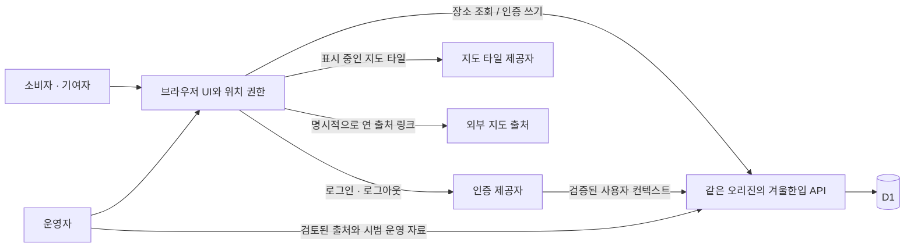
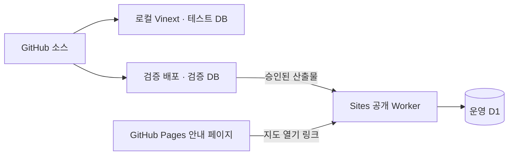

# 시스템 아키텍처 설계서 (SAD)

| 항목 | 내용 |
| --- | --- |
| 프로젝트 · 문서 | 겨울한입 · SAD-WINTER-v0.1 |
| 작성일 · 작성자 | 2026-11-24 · Codex |
| 상태 | G2 검토용 초안 · 승인 기록 없음 |
| 기준 | SRS-WINTER-v0.1 · UC-WINTER-v0.1 · RTM-WINTER-v0.1 |

## 변경 이력

| 버전 | 날짜 | 변경 |
| --- | --- | --- |
| v0.1 | 2026-11-24 | 서울 지도, 로그인 기여, 출처·운영 검토의 책임과 데이터 경계 정의 |

## 1. 문서 개요

소비자가 서울의 겨울간식 판매처를 발견하고 위치·영업·메뉴·후기를 바탕으로 방문을 판단할 수 있는 웹 시스템을 설계한다. 접근 제어, 조회와 쓰기의 분리, 출처와 현장 방문의 분리, 병합 시 기록 보존을 공통 기준으로 사용한다.

- 상위 근거는 [AGENT.md](../AGENT.md), [SRS](../01-요구사항분석/요구사항명세서-SRS.md), [유스케이스](../01-요구사항분석/유스케이스명세서.md), [RTM](../01-요구사항분석/요구사항추적매트릭스-RTM.md)다.
- 계약과 스키마는 [API 설계서](API설계서.md), [데이터베이스 설계서](데이터베이스설계서.md), [화면 설계서](화면설계서.md)에 둔다.
- 망원동 시범 배포와 아래의 서울 대상 설계를 구분한다. 공개 조회·기존 제보 등 시범 기능의 적용 수준은 DEC-006에서 배포 버전과 함께 대조한다.

## 2. 아키텍처 개요

### 시스템 컨텍스트

브라우저 현재 위치 원시는 권한 허용 후 브라우저 메모리에서 거리 계산에 사용한다. 앱 API·분석에는 보내지 않는다. 타일 요청은 지도 영역을 표시하기 위한 타일 인덱스로 구성한다. 제보에서 사용자가 확정한 **판매처 핀**과 거리 계산에 쓰는 **브라우저 현재 위치**는 입력 경계가 다르다.

### 컴포넌트

| 컴포넌트 | 책임과 경계 | 요구사항 |
| --- | --- | --- |
| 브라우저 탐색 | 공개 카탈로그 한 번의 조회, 같은 배열에서 자치구·간식·검색어 적용, 기기 내 거리순 정렬, 지도 핀·목록·상세 연결 | FR-001~004, NFR-001, NFR-003 |
| 세션·권한 | 인증 제공자가 확인한 신원을 앱 계정에 연결. 쓰기·소유권·운영 권한을 서버에서 판정. 공개 요청의 세션 유무가 결과 범위를 바꾸지 않음 | FR-005, NFR-002 |
| 판매처·제보 서비스 | 새 장소와 제보 기록의 원자적 등록, 기존 후보 연결, 정정·신고·방문 이력. 판매처 확인 상태와 최근 방문 상태를 별도 제공 | FR-006~009, FR-015~017, NFR-004 |
| 후기 서비스 | 본인 후기 조회·저장·삭제, 공개 후기와 같은 조건으로 평균·건수 계산 | FR-011~012, NFR-002, NFR-004 |
| 운영 검토 | 검토 작업 목록, 정정과 확인 결정, 중복 병합, 담당자·근거 DB 기록. 실패·충돌 시 데이터 무결성 유지 | FR-008~010, NFR-004~005 |
| 운영 작업 | 공개 전 확인한 입력 파일의 등록, 출처별·실물별 집계와 고정 실험 표본 내보내기. 운영 작업 자체를 대시보드 구축의 전제로 삼지 않음 | FR-013~014 |
| 저장소 | 판매처·출처·제보·방문·후기·운영 이력 보존. 공개 응답에서 자격·신고·내부 메타데이터 제외 | NFR-001~002, NFR-004~005 |

### 주요 데이터 흐름

| 흐름 | 처리 순서와 실패 경계 |
| --- | --- |
| 공개 지도 → 상세 | API-01이 공개 판매처의 축약 목록을 반환한다. 브라우저가 같은 시점의 결과를 목록과 지도에 사용한다. API-02·03으로 상세와 후기를 조회한다. 타일이 실패해도 목록과 등록 위치 텍스트는 제공한다. |
| 신규 제보 | UI-04에서 핀 확정과 중복 후보 검토 후 API-05로 요청한다. 세션·구역·입력 검증, 단건 생성과 제보 기록을 하나의 커밋으로 처리한다. 커밋 뒤 같은 판매처 ID와 확인 전 상태를 표시한다. |
| 정보 정정·후기 | 접수 데이터와 공개 판매처를 분리한다. 후기는 공개 모집단에서만 집계하며 수정·삭제 후 상세·후기를 갱신한다. 세션 만료로 실패한 쓰기는 사용자가 재인증 후 다시 제출한다. |
| 확인·병합 | 운영 결정에서 대상·버전·근거를 확인한다. 병합은 대표 ID와 출처·이력 재연결 및 감사 기록을 동일 트랜잭션에서 처리한다. 중간 실패 시 전체 변경을 취소한다. |
| 초기 카탈로그·실험 | 운영자가 검토한 출처와 실물 식별자로 재실행 가능한 입력을 준비한다. 공개 핀 집계와 출처별 조사 집계, 고정 실험 표본과 주민 기여 집계를 별도로 출력한다. |

## 3. 기술 스택 선정

| 영역 | 설계 기준선 | 근거와 검토 조건 |
| --- | --- | --- |
| UI | 기존 HTML·CSS·JavaScript 모바일 웹과 지도 UI 재사용 | 필터와 위치 계산을 브라우저에서 할 수 있다. [DESIGN.md](https://github.com/Uzn1/gyeoul-hanip/blob/main/DESIGN.md)의 토큰과 목록 양식을 기준으로 한다. |
| API | Vinext·Sites Worker의 단일 서버 배포 안에서 기능별 모듈화 | 기존 Worker와 같은 오리진에서 세션, 조회, 쓰기, 운영 권한을 일관되게 적용한다. 현행 `/api/community`와 목표 `/api/v1`의 전환 절차를 둔다. |
| DB | Cloudflare D1·SQLite, 기존 Drizzle 마이그레이션 구조 | 현행 저장소에서 출처·후기·감사 이력을 확장한다. 다중 변경은 D1 배치 트랜잭션으로 묶는다. [D1 Worker API](https://developers.cloudflare.com/d1/worker-api/d1-database/) |
| 인증 | 기존 Sites·ChatGPT 인증은 시범 호환 후보. 인증 어댑터 계약은 검증된 주체·역할만 사용 | 공개 소비자용 제공자와 세션, 사업주 확인은 DEC-002에서 정한다. |
| 지도 | 기존 OpenStreetMap 타일 사용을 검토 환경의 기준선으로 둔다. 외부 장소 프로필은 출처 링크로 연다. | 타일 서비스 이용 조건·표기와 예상 사용량을 출시 전에 확인한다. [OpenStreetMap 타일 이용 정책](https://operations.osmfoundation.org/policies/tiles/) |

별도의 서비스 배포, 검색 엔진이나 메시지 큐를 도입할 필요는 초기 데이터량과 운영 흐름에서 확인되지 않았다. NFR-006의 측정에 따라 조회 과정을 조정한다.

## 4. 배포 아키텍처

| 환경 | 데이터와 확인 |
| --- | --- |
| 로컬 | 로컬 D1과 예시 데이터를 사용한다. 모의 로그인은 개발 환경에서만 사용한다. |
| 검증 | 운영과 분리된 저장소에서 기존 스키마 복제 기반 마이그레이션, 권한, 병합 실패, 데이터 건수와 API 호환을 확인한다. |
| 공개 | 승인된 버전을 같은 오리진에서 서비스한다. 인증 설정과 운영 비밀은 배포 환경에 둔다. Pages는 지도 서비스로 연결한다. |

**전환과 복구.** 데이터 마이그레이션은 버전으로 검토한 뒤 적용한다. 추가 형태의 변경과 호환 검증을 앞에 두고, 필요한 변환은 별도 실행해 결과 건수·출처·ID를 대조한다. 구버전이 새 스키마에서 안전한지 확인한 후 배포를 교체한다. 파괴적 스키마 복구와 쓰기 재개는 DEC-007에 따른 복원 리허설 후 수행한다.

## 5. 아키텍처 결정 기록

| ID | 설계안 | 근거와 영향 | 상태 |
| --- | --- | --- | --- |
| ADR-001 | 브라우저와 같은 오리진의 단일 API, D1 유지 | 기존 배포 경로를 활용한다. 기능 경계는 배포가 아닌 모듈 및 권한으로 정의한다. | 제안 |
| ADR-002 | 공개 카탈로그 조회 후 브라우저에서 동일 결과를 필터링·정렬 | 위치 원시를 백엔드로 보내지 않고 지도와 목록을 일치시킨다. 데이터 증가 시 NFR-006을 기준으로 조회 범위를 검토한다. | 제안 |
| ADR-003 | 판매처 공개 범위, 존재 확인 상태, 오늘 방문 상태의 분리 | 외부 출처 등록과 새 주민 제보가 방문 확인으로 계산되는 문제를 방지한다. 전환 기준은 DEC-003에서 정한다. | 확인 전 즉시 공개 방향 합의 · 세부 제안 |
| ADR-004 | D1 배치에 기록 보존과 버전 조건, 감사 이벤트를 포함 | 재시도·동시 쓰기·부분 실패의 결과를 검사할 수 있다. 후기 충돌은 DEC-004 승인 전 병합을 보류하는 보수적 설계안이다. | 제안 |
| ADR-005 | 인증 제공자와 앱 권한을 분리 | 제공자 변경 시 공개 화면과 도메인 계약을 유지할 수 있다. 계정 매핑, 사업주 권한 부여는 DEC-002에 있다. | 조건부 |

## 6. 비기능 요구사항 대응

| ID | 대응·검증 |
| --- | --- |
| NFR-001 | 위치를 브라우저에 두고 서비스·분석 요청에 원시 좌표가 없는지 확인한다. 판매처 입력 좌표와 현재 위치 좌표를 UI·API에서 구별한다. |
| NFR-002 | 신뢰 경계 밖의 역할 값을 사용하지 않는다. 게스트, 본인, 타인, 운영자 식별이 필요한 쓰기를 직접 호출해 거절 결과와 변경 유무를 확인한다. |
| NFR-003 | 390px·1280px의 지도와 목록을 검증한다. 키보드만으로도 같은 상세와 주요 필터를 조작한다. |
| NFR-004 | D1 제약과 배치로 제출·병합 일관성을 유지한다. 네트워크 타임아웃 이후 재시도와 병합 중간 실패를 검증한다. |
| NFR-005 | 운영자 ID·대상·시간·근거를 감사 기록에서 추적한다. 서버 공개 응답의 허용 필드를 검증한다. |
| NFR-006 | 카탈로그 규모, 검증 기기, 네트워크를 고정한 뒤 초기 목록 표시와 필터 반영 시간을 측정한다. 판정 기준은 DEC-007에서 확정한다. |

## 7. 통합 패턴과 G2 검토

- 공개 읽기와 사용자 쓰기, 운영자 쓰기를 서버에서 구분하고, 인증 제공자의 검증 결과를 도메인 계정으로 변환한다.
- 앱 오류는 분류와 요청 ID로 추적한다. 결과가 비어 있는 응답, 권한 거부, 저장 실패는 다른 화면 상태를 사용한다. 오류 보고에 정확한 소비자 위치와 로그인 비밀을 포함하지 않는다.
- 출처 조사 건수와 중복 제거 공개 실적은 출시·실험 기록으로 남긴다. 외부 조회 자료를 API 쓰기 경로에서 자동 수집하지 않는다.
- G2 검토에서 보안 경계, 필드 값과 ID, 공개 상태와 읽기 범위, 병합 회귀, 배포 복구를 확인한다. DEC-001~007의 미결 항목을 [SRS](../01-요구사항분석/요구사항명세서-SRS.md#7-제약과-미결-결정)와 함께 검토한다. 승인 날짜·책임자·근거는 [단계별 검토 체크리스트](../08-검토/단계별검토-체크리스트.md)에 기록한다.
