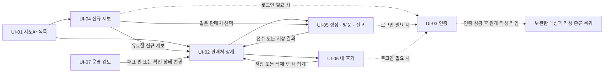

# 화면 설계서

| 항목 | 내용 |
| --- | --- |
| 프로젝트 · 문서 | 겨울한입 · UIX-WINTER-v0.1 |
| 작성일 · 작성자 | 2026-11-24 · Codex |
| 상태 | G2 검토용 초안 · 승인 기록 없음 |
| 기준 | [SRS](../01-요구사항분석/요구사항명세서-SRS.md) · [유스케이스](../01-요구사항분석/유스케이스명세서.md) · [RTM](../01-요구사항분석/요구사항추적매트릭스-RTM.md) |

## 변경 이력

| 버전 | 날짜 | 변경 |
| --- | --- | --- |
| v0.1 | 2026-11-24 | 서울 탐색과 판매처 상세, 제보·후기·운영 검토의 화면 흐름 및 상태 정의 |

## 1. 설계 원칙

- 지도 홈에서 내 주변이나 목적지 자치구의 겨울간식을 찾는다. 판매처의 위치와 취급 메뉴를 먼저 보여 준다.
- 같은 필터의 목록과 지도는 동일한 장소 ID를 사용한다. 핀이 겹치거나 타일을 불러오지 못한 경우에도 목록에서 상세를 연다.
- 비로그인 소비자가 지도·상세·후기를 읽는다. 쓰기 작업에서 로그인으로 이어지고 인증 후 해당 장소와 작성 의도로 복귀한다.
- **확인 전**은 판매처의 존재 확인 상태다. 오늘의 방문 상태·시각과 거리 기준은 따로 표시한다.
- [DESIGN.md](https://github.com/Uzn1/gyeoul-hanip/blob/main/DESIGN.md)의 따뜻한 바탕, 테라코타 주요 버튼, 간식별 아이콘과 핀을 사용한다. 상태는 글자로도 읽을 수 있어야 한다.

## 2. 화면 목록

| ID | 화면 · 접근 | 데이터 또는 주요 동작 | 요구사항 · 사용 흐름 |
| --- | --- | --- | --- |
| UI-01 | 지도·가까운 판매처 · 공개 | API-01, 기기 위치, 자치구·간식·검색 | FR-001~003, FR-017 · UC-001 |
| UI-02 | 판매처 상세 · 공개 | API-02, API-03, 출처와 후기, 제보 진입 | FR-004, FR-012, FR-016 · UC-002 |
| UI-03 | 인증·로그아웃 · 세션이 필요한 작업 | API-04, 제공자 로그인과 작업 복귀 | FR-005 · UC-003 |
| UI-04 | 판매처 신규 제보 · 기여자 | API-01의 후보, API-05 신규 등록 | FR-006~007, FR-017 · UC-004 |
| UI-05 | 정보·방문 제보와 오류 신고 · 기여자 | API-06, API-07 | FR-008, FR-015, FR-017 · UC-005, UC-007 |
| UI-06 | 후기 작성·수정·삭제 · 기여자 | API-08~10, API-03 재조회 | FR-011~012, FR-017 · UC-006 |
| UI-07 | 운영 검토·병합 · 운영자 | API-11~14, 내부 작업 결과 | FR-008~010, FR-013~014 · UC-008~010 |

초기 카탈로그와 실험 집계는 내부 입력·출력으로 검증한다. UI-07은 개별 신고와 장소 검토에 집중한다.

## 3. 화면 흐름



로그인 전 화면을 기록할 때는 같은 오리진의 대상 ID와 작성 종류만 반환 경로에 사용한다. 인증 중 유지할 작성 초안은 그 탭으로 제한하며 인증 비밀과 브라우저 현재 위치는 포함하지 않는다. 복귀 뒤 사용자가 내용을 확인하고 제출한다.

## 4. 화면 상세 명세

### UI-01 지도와 목록

1280px에서는 지도와 목록을 나란히 놓는다. 좁은 화면에서는 필터 아래 지도를 먼저 배치하고 목록을 뒤에 둔다. 내 위치와 검색·구역 선택은 첫 탐색에 필요한 조작으로 유지한다.

```text
1280px
[겨울한입]                                  [로그인] [판매처 제보]
[서울 전체 / 자치구] [전체] [붕어빵] [호떡] [군고구마] [어묵] [기타]
┌──────────────────────────────┬──────────────────────────┐
│ 서울 지도                    │ [간식이나 판매처 검색]     │
│ 판매처 핀                    │ 가까운 판매처 · 결과 수    │
│                             │ 서울시청 기준 / 내 위치 기준│
│           [＋] [−] [내 위치]    │ 이름 · 간식 · 거리 · 확인 상태│
└──────────────────────────────┴──────────────────────────┘

390px
[겨울한입] [로그인] [판매처 제보]
[서울 전체 / 자치구] [검색]
[가로 스크롤 가능한 간식 칩]
[지도 · 내 위치]
[가까운 판매처 · 결과 수 · 기준점]
[거리순 장소 행]
```

| 입력과 사건 | 출력과 상태 |
| --- | --- |
| 내 위치 | 사용자 행동 뒤 권한을 요청한다. 허용 시 내 위치 기준으로 정렬한다. 거부·실패 시 서울시청 기준과 계속 탐색할 수 있다는 문구를 표시한다. |
| 자치구, 간식, 검색 | 세 조건을 함께 적용하고 거리의 기준점을 화면에 남긴다. 필터로 제거된 핀은 목록에서도 제거된다. 거리는 직선 거리임을 표시한다. |
| 같은 장소의 핀·행 | 같은 ID 상세가 열린다. 상세를 닫으면 이전 목록 위치와 포커스를 복원한다. |
| 0건, 조회 오류, 타일 오류 | 0건은 필터 초기화와 제보 버튼, 조회 오류는 재시도 버튼을 제공한다. 타일 오류 시 조회가 성공한 목록과 상세는 제공한다. |

### UI-02 판매처 상세

| 표시 순서 | 내용과 상태 |
| --- | --- |
| 1. 장소 이름과 위치 | 간식 종류, 장소 이름, 확인 전 표시, 주소 또는 찾는 법과 선택한 핀. |
| 2. 판매와 방문 판단 | 판매 메뉴, 영업시간, 이용 방식, 제공 가능한 출처 링크와 갱신일. 영업시간이 없으면 **영업시간 미등록**, 이용 방식이 없으면 **이용 방식 확인 전**을 표시한다. |
| 3. 후기 | 평균과 후기 수, 공개 후기 목록, 내 후기 작성 진입. 0건은 **후기 없음**으로 표시한다. 페이지 조회 실패는 0건과 구별한다. |
| 4. 기록과 정정 | 승인된 경우 오늘·최근 현장 방문 표시, 기존 정보 제보, 신고. 온라인 지도 기록은 출처와 확인 일시로 표시한다. |

이용 방식의 표기는 **포장만**, **매장 이용만**, **포장·매장 이용 모두**, **이용 방식 확인 전**이다. `409 PLACE_MERGED`에 공개 대표 ID가 있으면 대상 이동 버튼을 제공하고 사용자가 대표 정보를 확인한다.

### UI-03 로그인·로그아웃

게스트의 쓰기 진입 시 어떤 판매처에 무엇을 작성하려는지 보여 준 뒤 인증 제공자로 이동한다. 로그인 뒤 대상이 유효하면 원래 작성 화면으로 돌아오고, 대상이 병합됐으면 대표 정보를 다시 확인하도록 한다. 인증 취소·실패에는 재시도와 지도 복귀를 제공한다. 로그아웃 뒤에도 공개 지도·상세·후기 조회가 가능하다. 로그인 제공자 표기와 사업주 자격은 DEC-002에서 확정한다.

### UI-04 신규 판매처 제보

1. 키보드 또는 포인터로 공개할 판매처 핀을 확정한다. 지도 중심을 핀으로 지정할 수 있다.
2. 근처 후보의 이름·간식·거리를 보여 준다. 같은 곳을 고르면 기존 제보 화면으로 이어지고, 별개 장소는 새 제보 폼에서 계속한다.
3. 이름, 자치구, 간식 종류와 위치 단서 또는 공개 출처를 입력한다. 승인된 증빙 조건은 필드 도움말에 표시한다. 정확한 필수 조건은 DEC-003을 따른다.
4. 정상 완료 시 **확인 전** 표기가 있는 새 상세를 열고 같은 위치의 핀을 확인할 수 있게 한다.

서버 입력 오류에는 필드 가까이에 사유를 표시하고 첫 오류로 포커스를 이동한다. 네트워크 실패의 재시도에서 같은 작성 요청과 입력을 유지한다. 위치를 다시 찍는 동안 작성값을 보존한다.

### UI-05 정정·방문·오류 신고

기존 판매처의 이름과 위치를 상단에 유지한다. 정보 정정은 변경할 정보와 근거를, 오류 신고는 잘못된 위치·중복·폐점 의심 중 이유를 받는다. 중복일 때 대응 장소를 선택한다. 승인된 방문 관찰 화면은 **판매 중**, **품절**, **현장에서 못 찾음**을 제공한다.

접수 완료에는 접수 사실을 표시한다. 정정 또는 신고의 검토 이후에 공개 정보의 변경 결과를 표시한다. 대상이 바뀌거나 저장이 실패하면 새로고침, 대표 핀 확인, 재시도로 이어지게 한다.

### UI-06 후기 관리

1~5의 이름이 있는 별점 버튼과 후기 입력란을 제공한다. 키보드 사용 시 선택 값과 포커스가 모두 읽혀야 한다. 자신의 후기가 있으면 해당 기록의 수정·삭제 화면을 연다. 편집 동작은 자신의 후기에만 제공하고 서버에서도 권한을 검사한다. 제출·삭제 뒤 상세로 돌아가 공개 목록·개수·평균을 새로 읽는다. 별점 범위, 후기 글 조건과 신고·숨김 정책은 DEC-004에서 확정한다.

### UI-07 운영 검토·중복 병합

| 영역 | 정보와 조작 |
| --- | --- |
| 케이스 목록 | 확인 전 후보와 정정·오류 신고를 각각 조회한다. 장소 이름, 사유, 접수 시각과 처리 상태를 표시한다. |
| 검토 상세 | 장소 정보와 버전, 출처, 최근 방문과 신고를 함께 표시한다. 승인된 결정과 그 근거 입력을 제공한다. |
| 병합 확인 | 원본과 유지할 대표 장소의 이름·자치구·주소·핀을 비교한다. 대표 판매처와 이력 보존을 확인한 후 근거를 입력해 병합한다. |
| 실패 처리 | 버전 충돌은 상세를 다시 읽게 하고, 후기 충돌에 대한 규칙이 미정이면 보류 이유를 표시한다. 운영 접근 권한이 필요하다는 안내를 별도 제공한다. |

## 5. UX 검토와 디자인 토큰

| 검토 항목 | 기준 |
| --- | --- |
| 모바일·데스크톱 | 390px과 1280px에서 같은 장소의 주요 필드와 필터에 접근할 수 있다. 700px 이하의 기본 지도·목록은 세로로 쌓고 간식 칩은 필요 시 가로로 스크롤한다. |
| 접근성 | 필터에 선택·스위치 상태를 제공한다. 키보드로 목록에서도 상세를 열고 닫을 수 있다. 저장·조회 오류와 결과 변경은 보조기기가 인지할 수 있어야 한다. 상태 색에 텍스트를 병행한다. |
| 스타일 | 배경 `#f9f6ee`, 표면 `#fffdf8`, 주요 행동 `#a94025`, 기본 글자 `#282721` 기준. 본문 16px, 주요 제어와 필드는 14px 이상을 기준으로 검증한다. [DESIGN.md](https://github.com/Uzn1/gyeoul-hanip/blob/main/DESIGN.md) |
| 검증 | 필터 일치 TC-FN-MAP-004, 미등록 상세 TC-FN-INFO-002, 확인 전 공개 TC-FN-REP-001, 후기 0건 TC-FN-REV-005, 운영 병합 TC-FN-OPS-002, 반응형·키보드 TC-NF-UX-001~002를 설계 검토에 사용한다. |

타일 출처는 지도 위에서 식별 가능하게 유지한다. 검증 결과와 기준 미달 항목은 [RTM](../01-요구사항분석/요구사항추적매트릭스-RTM.md)에 연결한다. 인증, 제보·상태 전환, 후기의 미결 기준은 DEC-002~004를 따라 갱신한다.

[AGENT.md](../AGENT.md) · [API 설계서](API설계서.md) · [SAD](시스템아키텍처설계서-SAD.md) · [데이터베이스 설계서](데이터베이스설계서.md)
